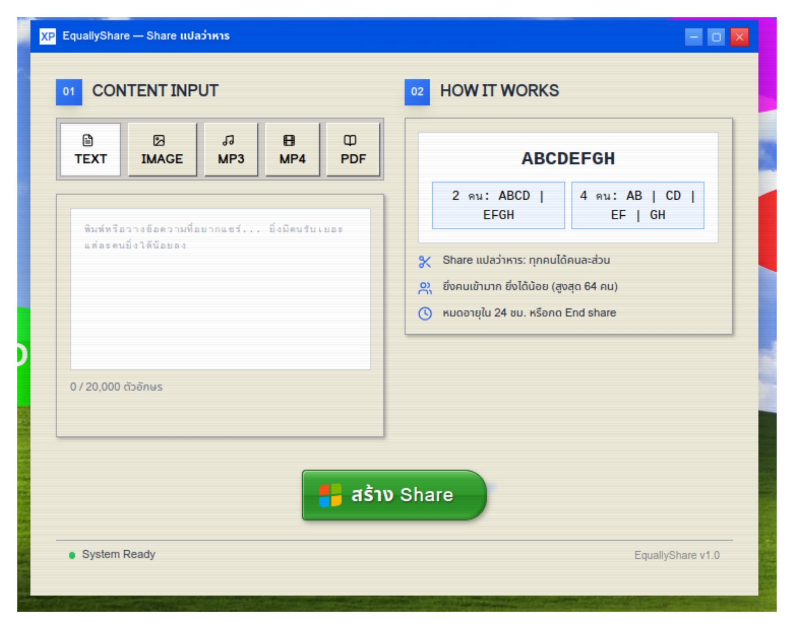
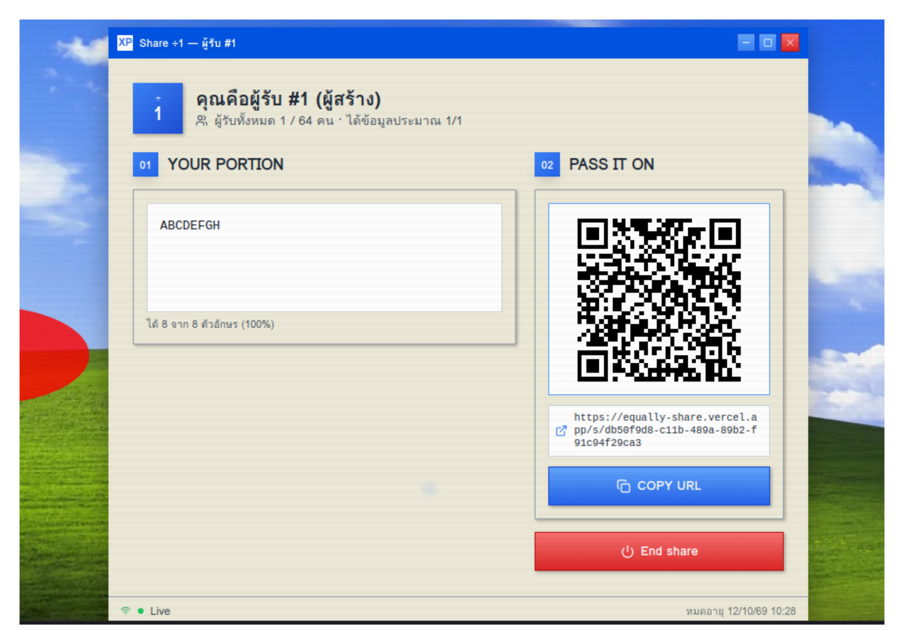
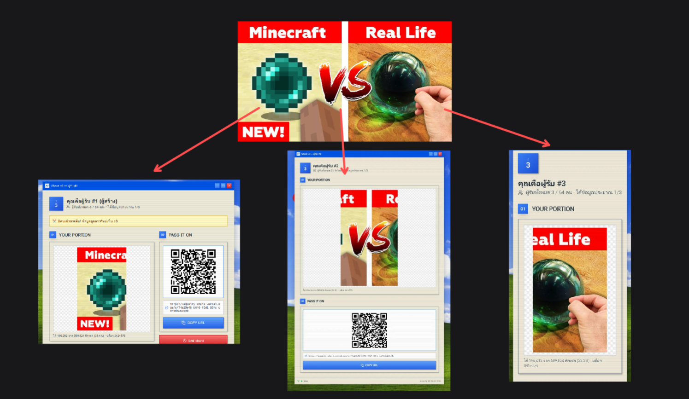

<p align="center">
  
</p>

# EquallyShare — Share แปลว่าหาร

เว็บแชร์ข้อมูลที่ตีความคำว่า **Share** แบบตรงตัว: เอาข้อมูลมา **หาร** ตามจำนวนคนรับ ยิ่งมีคนเปิดลิงก์มาก แต่ละคนก็ยิ่งได้ข้อมูลน้อยลง!

โปรเจกต์สำหรับ **Stupid Hackathon 2026** มาในหน้าตา Windows XP รองรับข้อความ ภาพ เสียง MP3 วิดีโอ MP4 และ PDF

**[ลองเล่นบนเว็บ →](https://equally-share.vercel.app/)**

## มันหารยังไง?

สมมติคุณแชร์ข้อความ `ABCDEFGH`

| จำนวนผู้รับ | สิ่งที่แต่ละคนได้รับ |
| --- | --- |
| 1 คน | `ABCDEFGH` |
| 2 คน | `ABCD` · `EFGH` |
| 4 คน | `AB` · `CD` · `EF` · `GH` |

ทุกครั้งที่มีผู้รับใหม่ ข้อมูลต้นฉบับจะถูกแบ่งใหม่ และหน้าของผู้รับเดิมจะอัปเดตให้อัตโนมัติ คนสร้างก็นับเป็นผู้รับคนแรกด้วย

## วิธีใช้

### 1. เลือกข้อมูลที่อยากแชร์

เลือกประเภท **TEXT, IMAGE, MP3, MP4 หรือ PDF** แล้วพิมพ์ข้อความหรืออัปโหลดไฟล์ จากนั้นกด **สร้าง Share**



### 2. ส่งลิงก์หรือ QR ให้คนอื่น

หลังสร้าง คุณจะเห็นส่วนข้อมูลของตัวเอง พร้อม QR code และปุ่ม **COPY URL** ส่งลิงก์ให้เพื่อน หรือให้เพื่อนสแกน QR เพื่อเข้าร่วมได้เลย ไม่ต้องสมัครบัญชี



### 3. ดูข้อมูลถูกหารไปเรื่อย ๆ

เมื่อคนใหม่เข้ามา ส่วนของทุกคนจะเปลี่ยนตามจำนวนผู้รับ เช่น ภาพหนึ่งภาพถูกแบ่งเป็นพื้นที่คนละส่วน ทุกคนได้รับเฉพาะส่วนของตัวเอง



## ข้อมูลแต่ละประเภทแบ่งแบบไหน?

| ประเภท | วิธีแบ่ง |
| --- | --- |
| ข้อความ | แบ่งเป็นช่วงข้อความตามลำดับ โดยไม่ตัดกลาง emoji หรือกลุ่มอักขระ |
| ภาพ | แบ่งเป็นช่องสี่เหลี่ยมของภาพต้นฉบับ |
| MP3 | แบ่งเป็นช่วงเสียงตามลำดับ |
| MP4 | แบ่งเป็นช่วงวิดีโอตามจุด keyframe |
| PDF | แบ่งเป็นช่วงหน้า แต่ละคนได้รับเฉพาะหน้าของตัวเอง |

## กติกาเล็ก ๆ

- รองรับสูงสุด **64 ผู้รับต่อ Share** ตามค่าเริ่มต้น
- จำนวนผู้รับนับสะสม ปิดแท็บแล้วส่วนแบ่งไม่คืน
- เปิดซ้ำใน browser เดิมยังเป็นผู้รับคนเดิม
- ถ้าข้อมูลไม่พอแบ่ง บางคนอาจได้รับส่วนว่าง เช่น **“คุณได้รับข้อมูล 0 ตัวอักษร”**
- Share หมดอายุใน **24 ชั่วโมง** หรือผู้สร้างกด **End share** เพื่อจบก่อน
- ต้นฉบับแก้ไม่ได้หลังสร้าง ถ้าจะเปลี่ยนข้อมูลให้สร้าง Share ใหม่

## รันในเครื่อง

ใช้ **Node.js 22** และ npm

```sh
npm install
npm run dev
```

เปิด [http://localhost:3000](http://localhost:3000) เพื่อใช้งาน ดูการตั้งค่า Supabase, Vercel และขนาดไฟล์ที่รองรับได้ใน [คู่มือติดตั้ง](docs/setup.md)

สร้างด้วย React, TypeScript, Vite และ Express พร้อม Supabase สำหรับฐานข้อมูล การเก็บไฟล์ และการอัปเดตแบบ realtime
